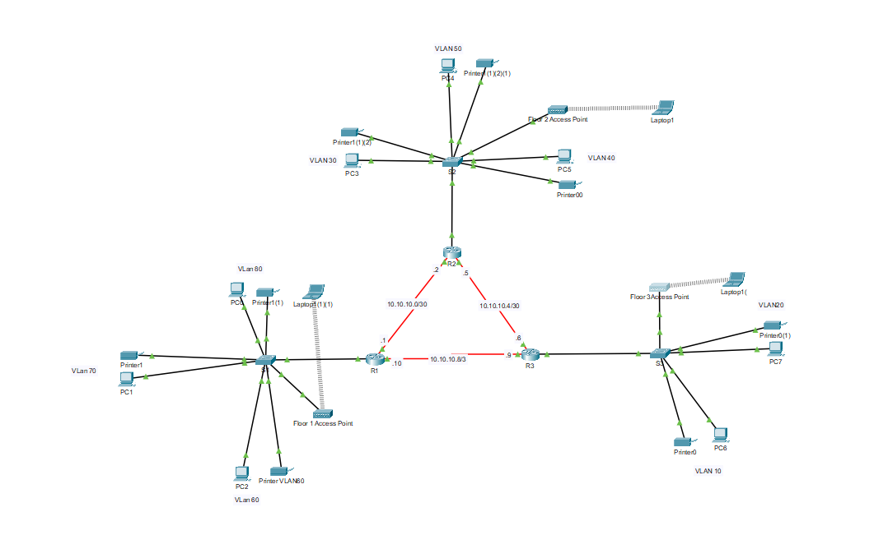
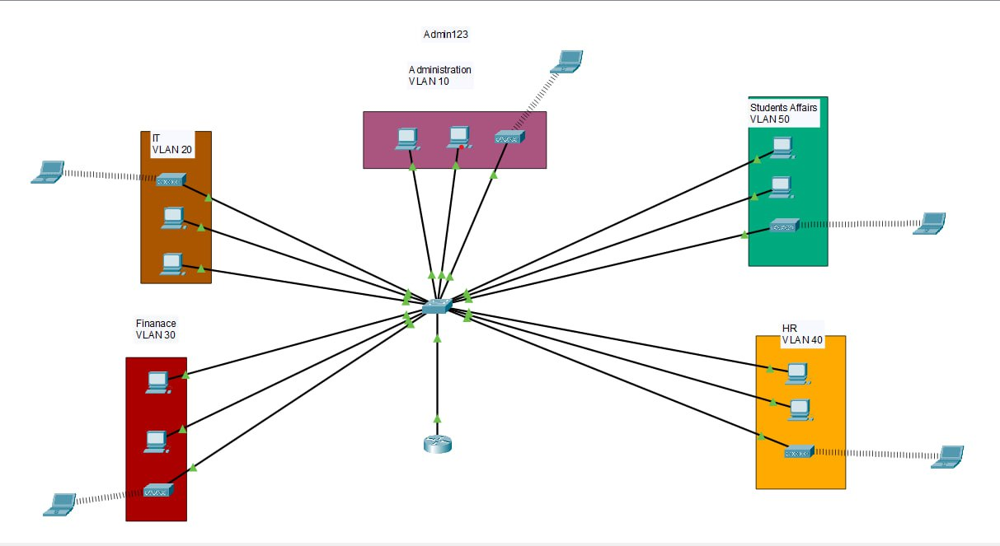

# Packet Tracer Network Designs

**Every network I designed and configured at university in Cisco Packet Tracer, from my first subnet to a three-router enterprise network.**

---

## Contents

| # | Folder | Course · Year | What's inside |
|---|---|---|---|
| 01 | [Network Fundamentals project](01-network-fundamentals-project) | Network Fundamentals · Y2 | First full topology: addressing and subnetting a small network |
| 02 | [Cisco labs](02-cisco-labs) | Switching & Routing · Y3 | One `.pkt` per protocol (see the lab table below) |
| 03 | [UNIY University branch (midterm)](03-switching-routing-midterm) | Switching & Routing · Y3 | 5 departments, 5 VLANs, router-on-a-stick, DHCP, Wi-Fi |
| 04 | [**FOODY Company network (final)**](04-switching-routing-final) ⭐ | Switching & Routing · Y3 | 3 floors, 3 routers, 8 VLANs, EIGRP, DHCP, Wi-Fi, SSH |
| 05 | [Wireless security final](05-wireless-security-final) | Wireless Network Security · Y3 | Secured wireless topology |

## ⭐ Featured: FOODY Company network

> *"FOODY is a fast-growing food company with about 1.5 million customers, operated from a three-floor headquarters in Sana'a."* (from the project brief)

**Requirements I implemented:**

- **Three routers**, one per floor, all in the IT server room and fully meshed over **serial links** (`10.10.10.0/30`, `.4/30`, `.8/30`).
- **One switch per floor**, with **one VLAN per department** and a printer in each department.
- **EIGRP** for dynamic routing between floors.
- **Wi-Fi access point on every floor**, with **DHCP** for laptops and phones.
- **Inter-VLAN routing**, so every department can reach every other.
- **SSH** on all routers for secure remote management.

**Addressing plan** (`172.16.0.0/16` split into equal `/19` blocks):

| Floor | Department | VLAN | Subnet |
|---|---|---|---|
| 1 | Reception | 80 | `172.16.0.0/19` |
| 1 | Store | 70 | `172.16.32.0/19` |
| 1 | Marketing | 60 | `172.16.64.0/19` |
| 2 | Finance | 50 | `172.16.96.0/19` |
| 2 | HR | 40 | `172.16.128.0/19` |
| 2 | Sales | 30 | `172.16.160.0/19` |
| 3 | Administration | 20 | `172.16.192.0/19` |
| 3 | IT | 10 | `172.16.224.0/19` |

The full report (building sketch, configs and per-AP settings) is in [`documentation.pdf`](04-switching-routing-final/documentation.pdf).

## UNIY University branch (midterm)

The constraint was a **single router and a single switch** for five departments (Administration, IT, Finance, HR, Students Affairs). The ISP block `192.168.40.0/24` is subnetted into five VLANs, with **router-on-a-stick** for inter-VLAN routing and **DHCP** for wireless clients.

## Cisco labs

| Lab | Topic |
|---|---|
| `02-STP-Lab.pkt` | Spanning Tree Protocol: root bridge election, blocked ports |
| `03-VLAN.pkt` | VLAN creation and access ports |
| `04-VTP.pkt` | VLAN Trunking Protocol: server/client domains |
| `05-interVLAN_routing.pkt` | Router-on-a-stick with sub-interfaces |
| `06-static-routing.pkt` | Static routes |
| `06-RIPv1/` | RIPv1 in three scenarios (A, B, C) plus the base topology |
| `07-RIPv2.pkt` | RIPv2, classless routing |
| `08-EIGRP.pkt`, `additional/08-EIGRP-2.pkt` | EIGRP configuration |

## How to open

1. Install **[Cisco Packet Tracer](https://www.netacad.com/courses/packet-tracer)**. It's free with a Cisco NetAcad account.
2. Open any `.pkt` file.
3. Switch to **Simulation mode** to watch packets travel, or open a router's **CLI** and run `show running-config`, `show ip route` or `show vlan brief`.

## What I learned

- Planning address space **before** placing devices. Subnetting tables saved me hours of reconfiguration.
- Why VLANs matter for security and broadcast control, and how to route between them.
- The difference between static, distance-vector (RIP) and advanced distance-vector (EIGRP) routing.
- Locking down device management with **SSH** instead of Telnet.

## Author

**Humam Al-Dhubhani**, Cyber Security, Ar-Rasheed University · [GitHub](https://github.com/humamaldhubhani)

Released under the [MIT License](LICENSE).
